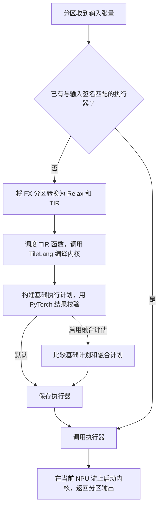

# Ascend 后端的编译与执行流程

使用 `torch.compile(..., backend="tilelang")` 时，TorchDynamo 捕获模型的计算过程，生成 FX 图。Ascend 后端从图中选出可以编译的算子，将它们组成一个或多个分区。每个分区第一次收到实际输入时，后端才调用 TileLang 编译在 NPU 上运行的计算内核（kernel）。后续调用可以复用编译结果。[后端注册](../pyproject.toml) · [后端实现](../src/torch_tilelang/backend.py)

## 从 FX 图到分区

后端先确定 AscendC 或 PTO 编译目标及其执行适配器，并检查 TileLang 是否提供对应的代码生成器。目标和适配器不兼容、代码生成器缺失等错误在分区前就会抛出。[目标配置与用法](ascend.md) · [目标解析](../src/torch_tilelang/compat/tilelang.py)

后端接着检查 FX 图。原地修改张量等操作会让整张图默认留在 PyTorch。对于可以安全分区的图，后端用 `_CompiledPartition` 包装每个支持的分区。`torch.sin` 等已知的纯算子可以留在两个编译分区之间，由 PyTorch 执行。一个分区可以包含多个内核。[分区逻辑](../src/torch_tilelang/backend.py)

下图展示一个分区成功编译后的执行路径，以及后续调用如何复用执行器。

## 首次调用如何编译分区

1. **转换计算图。** 分区的 `_prepare` 方法检查输入张量后，调用 `fx_to_relax` 将 FX 算子转换为 Relax 操作。`LegalizeOps` 再将这些操作的具体计算转换为 TIR 函数（`PrimFunc`）。Relax 主函数保留各步之间的数据依赖，并通过 `call_tir` 调用相应的 TIR 函数。[前端转换](../src/torch_tilelang/frontend.py)
2. **调度并编译内核。** 对每个 TIR 函数，`schedule_primfunc` 先尝试逐元素调度。如果不适用，再依次尝试归约和矩阵乘法调度。`compile_kernel` 将调度后的函数交给 `tilelang.compile` 编译。AscendC 路径使用 `tvm_ffi` 执行适配器，PTO 路径使用 `pto` 执行适配器。[调度选择](../src/torch_tilelang/schedules/ascend/schedule.py) · [TileLang 编译入口](../src/torch_tilelang/compat/tilelang.py)
3. **生成并校验执行计划。** `TorchGraphRunner` 根据 Relax 图确定内核的调用顺序，以及每次调用所需的张量。随后，`validate_runner` 用同一组输入分别运行基础执行计划和原始 PyTorch 分区，比较两者的输出。默认情况下，后端保存通过校验的基础执行器。启用 `fusion="profile"` 后，后端还会尝试编译融合后的分区，根据输出是否正确、实测性能是否达标来决定是否采用融合方案。[执行计划](../src/torch_tilelang/runtime.py) · [校验与融合选择](../src/torch_tilelang/fusion.py)

## 后续调用如何复用执行器

每个分区只保存最近一次准备好的执行器。签名包含当前的梯度跟踪模式，以及每个输入张量的形状、数据类型、设备、步幅、存储偏移和 `requires_grad`。仅改变张量的值会复用执行器。签名变化时，分区重新准备执行器。[签名计算与执行器复用](../src/torch_tilelang/backend.py)

每次运行已编译的分区时，执行器都按计划逐个启动内核。每个内核调用前，执行器先用 PyTorch 分配输出张量，再将输入和输出张量交给执行适配器。内核在当前 NPU 流上运行，分区最后返回计划指定的输出。[内核调用与张量分配](../src/torch_tilelang/runtime.py)

## 失败时如何处理

默认情况下，如果分区编译失败，或基础执行计划的输出未通过校验，后端会回退到该分区原有的 PyTorch 实现。启用 `strict=True` 后，这两类失败会直接抛出异常。即使开启严格模式，支持分区之间仍允许执行纯 PyTorch 节点，融合方案被拒绝时仍会使用已验证的基础计划。设备执行期间发生的错误会直接传给调用方。[回退与错误处理](../src/torch_tilelang/backend.py)

要确认是否运行了 TileLang 内核，可以在传给 Dynamo 的后端函数中保存返回执行器的 `graph_report`。整图回退时，原因在 `graph_report.fallback_reason` 中。如果图被分区，`graph_report.partitions` 会列出各分区的目标后端、执行适配器、计划中的内核调用点数，以及编译路径和回退路径各自的调用次数。[报告采集示例](../tests/ascend/test_backend.py)
